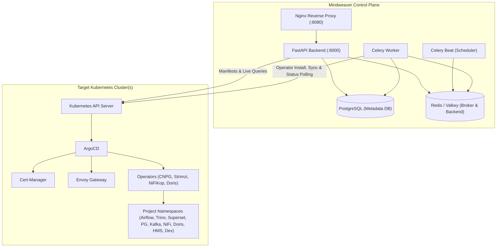

<!--
SPDX-FileCopyrightText: Copyright © 2026 Mohd Izhar Firdaus Bin Ismail
SPDX-License-Identifier: AGPLv3+
-->

# Mindweaver Administrator Manual

Welcome to the **Mindweaver Administrator Manual**. This documentation is designed for system administrators, platform engineers, and DevOps operators responsible for installing, configuring, securing, and maintaining Mindweaver and its managed Kubernetes environments.

## Chapters

1. **[Installation & Production Deployment](installation-and-deployment.md)**
   Prerequisites, Kubernetes cluster preparation (`k3s`, MetalLB, CloudNativePG), Helm chart deployment, Docker Compose deployment, and post-installation bootstrap (`db migrate` and `stack import`).
2. **[Configuration, Authentication & Security](configuration-and-security.md)**
   Complete `MINDWEAVER_*` environment variable reference, local and OIDC authentication, Superadmin & Role-Based Access Control (RBAC), Fernet secret encryption, redaction conventions, and encryption key rotation.
3. **[Cluster, Stack & Environment Management](cluster-and-environment-management.md)**
   Registering Kubernetes clusters, installing and syncing core cluster operators (ArgoCD, Cert-Manager, CloudNativePG, Envoy Gateway, Strimzi, NiFiKop, Doris Operator), managing component Stacks, global LDAP configurations, Project networking/Gateways, per-project Dex OIDC identity, and PKI certificate lifecycle management.
4. **[Connectivity & Platform Services Administration](connectivity-and-platform-services.md)**
   Managing project-scoped connectivity resources (S3 Storage, SSH Keys, Git Repositories, Container Registries, Trusted Certificates, Database Sources) and administering the lifecycle and dependencies of platform services (PostgreSQL, Apache Doris, Hive Metastore, Trino, Apache Kafka, Apache NiFi, Apache Airflow, Apache Superset).
5. **[CLI Reference, Maintenance & Troubleshooting](cli-maintenance-and-troubleshooting.md)**
   Complete `mindweaver` CLI reference, Celery background task and queue management, database maintenance, and operational troubleshooting runbooks.

---

## System Architecture for Administrators

Mindweaver operates as a centralized control plane and metadata registry that orchestrates data and AI platform components on one or more target Kubernetes clusters via **ArgoCD** and native Kubernetes APIs.

### Key Control Plane Components

| Component | Role | Default Port / Process |
| :--- | :--- | :--- |
| **Web / Reverse Proxy** | Serves the compiled React SPA and proxies `/api/v1`, `/health`, and `/feature-flags` to the FastAPI backend. | `8080` (Nginx) |
| **FastAPI Backend** | Handles REST / JSON:API requests, authentication, secret encryption, manifest rendering, and synchronous Kubernetes interactions. | `8000` (`uvicorn`) |
| **PostgreSQL Database** | Stores Mindweaver metadata, encrypted credentials, project definitions, dependency graphs, and cached cluster/platform state. | `5432` |
| **Redis / Valkey** | Message broker and result backend for Celery asynchronous tasks and periodic status polling. | `6379` |
| **Celery Beat** | Schedules periodic background tasks (15-second cluster & platform status polling, daily name tracker cleanup). | `mindweaver scheduler` |
| **Celery Worker** | Executes asynchronous cluster installations, project integration syncs, and periodic health/status pollers. | `mindweaver worker` |

---

## Related Documentation

- **[User Documentation](../user/README.md)**: End-user guides for navigating projects, deploying components, and managing metadata.
- **[Developer Documentation](../developer/README.md)**: Internal framework architecture, coding standards, and test suite guides.
- **[Architecture Decision Records (ADRs)](../architecture-decisions/)**: Historical design decisions and technical specifications.
