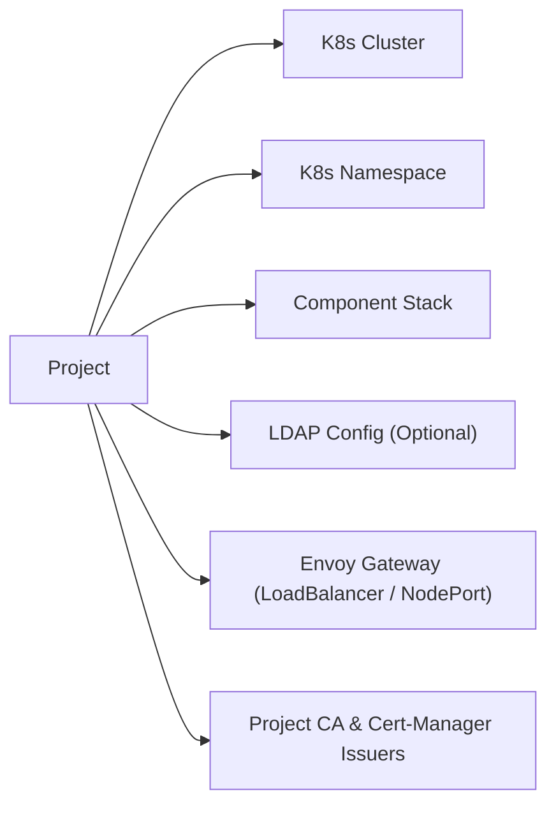

<!--
SPDX-FileCopyrightText: Copyright © 2026 Mohd Izhar Firdaus Bin Ismail
SPDX-License-Identifier: AGPLv3+
-->

# Cluster, Stack & Environment Management

Before users can deploy data platform components, an administrator must configure the global environment resources located under the **Environment** section of the sidebar:
1. **K8s Clusters** (`/k8s_clusters`)
2. **Stacks** (`/stacks`)
3. **LDAP Configs** (`/ldap-configs`)
4. **Projects** (`/projects`)

---

## 1. Managing Kubernetes Clusters (`/k8s_clusters`)

Mindweaver can orchestrate workloads on the cluster where it is hosted or on external remote Kubernetes clusters.

### Registering a Cluster
Navigate to **Environment > K8s Clusters** and create a new cluster:
- **Name & Title**: Unique identifier and human-readable display name.
- **Type**:
  - `remote` *(Default)*: Connects using an explicit `kubeconfig` YAML stored encrypted in the database. Ensure the server address in `kubeconfig` is reachable from the Mindweaver API and Celery Worker containers/pods (avoid `127.0.0.1` unless running on host networking).
  - `in-cluster`: Uses the Kubernetes ServiceAccount mounted into the Mindweaver pods (`config.load_incluster_config()`). Requires `rbac.create: true` in the Mindweaver Helm chart.
- **Kubeconfig**: Required when `type` is `remote`. Encrypted at rest and redacted as `__REDACTED__` via the API.

### Cluster Health Polling
Celery Beat polls all registered clusters every **15 seconds** (`poll-all-k8s-clusters-15s`) and administrators can trigger an immediate check via the **Refresh** button (`POST /api/v1/k8s_clusters/{id}/_refresh`). The poller records:
- Cluster status (`online`, `offline`, `error`) and Kubernetes server version.
- Node count, individual node readiness (`nodes_status`), and node IP addresses (`node_ips`).
- Total vs. allocated CPU cores (`cpu_total`, `cpu_allocated`) and RAM (`ram_total`, `ram_allocated`).
- Installation status and versions of all core cluster operators.

> [!WARNING]
> If a cluster becomes unreachable (`status == "error"`), Mindweaver automatically marks all active platform services running in projects on that cluster as `error` (`Cluster '<name>' is unreachable`) and clears their live endpoint URLs until connectivity is restored.

---

## 2. Core Cluster Integrations & Operators

Mindweaver relies on Kubernetes operators and ArgoCD to manage the lifecycle of platform components. From a cluster's detail view, administrators can install operators individually or click **Sync Core Integrations** (`POST /api/v1/k8s_clusters/{id}/_action/sync_core_integrations`) to install/update all of them sequentially in the background via Celery.

| Integration / Action | Mechanism | Target Namespace | Purpose |
| :--- | :--- | :--- | :--- |
| **ArgoCD** (`install_argocd`) | `helm upgrade --install` | `argocd` | Core GitOps controller that reconciles `Application` manifests for all other operators and platform services. |
| **Cert-Manager** (`install_cert_manager`) | ArgoCD `Application` | `cert-manager` | Automates TLS certificate issuance and renewal across project namespaces. |
| **CloudNativePG** (`install_cnpg_operator`) | ArgoCD `Application` | `cnpg-system` | Manages high-availability PostgreSQL clusters (`postgresql.cnpg.io/v1`). |
| **Envoy Gateway** (`install_envoy_gateway`) | ArgoCD `Application` + `GatewayClass` & `EnvoyProxy` | `envoy-gateway-system` | Provides Kubernetes Gateway API ingress routing and TLS termination for project services. |
| **Kafka Operator** (`install_kafka_operator`) | ArgoCD `Application` | `strimzi` | Deploys Strimzi Kafka Operator for managing Kafka clusters and `KafkaNodePool` resources. |
| **NiFiKop Operator** (`install_nifikop`) | ArgoCD `Application` | `nifikop` | Manages Apache NiFi clusters (`NifiCluster`). |
| **Doris Operator** (`install_doris_operator`) | ArgoCD `Application` | `doris` | Manages Apache Doris FE/BE clusters (`DorisCluster`). |

> [!TIP]
> Always install **ArgoCD** first (or use **Sync Core Integrations**, which installs ArgoCD as Step 1), because Cert-Manager, CNPG, Envoy Gateway, Strimzi, NiFiKop, and Doris Operator are deployed as ArgoCD `Application` resources.

---

## 3. Managing Component Stacks (`/stacks`)

A **Stack** defines the exact Helm chart repositories, chart names, chart versions, and container image tags used when deploying both core cluster operators and project platform services.

### Default Stack Configuration
Mindweaver ships with stack definitions in `backend/src/mindweaver/resources/stacks/` (e.g., `mindweaver-0.1.0-alpha.1.yml`), defining versions for:
- **Platform Services**: `pgsql`, `nifi`, `airflow`, `kafka`, `superset`, `hive_metastore`, `trino`, `doris`
- **Core Integrations**: `argocd`, `cert-manager`, `cnpg`, `envoy-gateway`, `kafka-operator`, `nifikop-operator`, `dex`, `doris-operator`

### Importing or Updating Stacks
To load or refresh stacks from YAML files into the database:

```bash
# Import built-in stacks
uv run mindweaver stack import

# Import custom stacks from a custom directory (e.g., for air-gapped / private registries)
uv run mindweaver stack import --path /path/to/custom-stacks/
```

Each YAML file must include `name`, `title`, `version`, and `configuration.components`:

```yaml
name: mindweaver-0.1.0-internal
title: Mindweaver 0.1.0 (Internal Mirror)
version: 0.1.0-internal.1
configuration:
  components:
    trino:
      charts:
        main:
          repo: https://charts.internal.example.com/trino
          chart: trino
          version: "1.41.0"
      images:
        main:
          image: registry.internal.example.com/trinodb/trino
          tag: "482"
```

---

## 4. Global LDAP Configurations (`/ldap-configs`)

To enable centralized directory authentication for project services (such as Apache Superset, Apache Airflow, Apache NiFi, and Dex), register an LDAP server under **Environment > LDAP Configs**:

- **Server URL**: Must start with `ldap://` (port 389 default) or `ldaps://` (port 636 default).
- **Bind DN & Bind Password**: Service account DN used to search directory entries (Bind Password is encrypted at rest).
- **User Search Base**: Base DN for user lookups (e.g., `ou=users,dc=example,dc=com`).
- **User Search Filter**: Filter expression (e.g., `(objectClass=inetOrgPerson)` or `(uid={0})`).
- **Username Attribute**: Attribute mapped to username/email (e.g., `uid`, `cn`, or `mail`).
- **Group Search Base / Filter / Member Attributes**: Optional group lookup configuration (`group_search_base`, `group_search_filter`, `group_member_attr`, `user_group_attr`) used for role mapping in Superset, Airflow, and NiFi.
- **Verify SSL**: Whether to validate the LDAP server's TLS certificate on `ldaps://` connections.

Use the **Test Connection** button (`POST /api/v1/ldap-configs/_test-connection`) to verify bind credentials before linking the LDAP configuration to a Project.

---

## 5. Project Administration (`/projects`)

A **Project** binds a logical team or environment to a target Kubernetes namespace and cluster.



### Project Configuration Fields
- **Name & Title**: Project identifier and display name.
- **K8s Cluster**: The target Kubernetes cluster where project resources will be deployed.
- **K8s Namespace**: Target Kubernetes namespace (max 32 characters; defaults to the project `name` if omitted).
- **Stack**: The component Stack governing chart and image versions for this project.
- **LDAP Config**: Optional LDAP directory linked to this project.
- **Ingress Domain**: Base domain for exposing web UIs via Envoy Gateway (e.g., `proj1.data.example.com`).
- **Envoy Gateway Service Type**:
  - `LoadBalancer` *(Default)*: Allocates an external LoadBalancer IP for the project's Envoy Gateway.
  - `NodePort`: Exposes the project's Envoy Gateway on a cluster NodePort (`envoy_nodeport`).

### Syncing Project Integrations (`sync_project_integrations`)
Once a Project has a cluster and `ingress_domain` configured, trigger **Sync Project Integrations** (`POST /api/v1/projects/{id}/_action/sync_project_integrations`). This action renders and applies:
1. **ArgoCD `AppProject`** (`00-argocd-project.yml.j2`): Scopes ArgoCD applications for this project.
2. **Project Self-Signed CA & Cert-Manager Issuers** (`02-self-signed-issuer.yml.j2`):
   - Creates `{project}-bootstrap-issuer` (self-signed), issues a Project CA certificate stored in `{project}-ca-secret`, and creates `{project}-selfsigned-issuer` (CA Issuer backed by `{project}-ca-secret`) in the project namespace.
3. **Trusted Certificates Bundle** (`03-trusted-certs.yml.j2`): Syncs all project `TrustedCert` records into a Kubernetes Secret in the project namespace.
4. **Project Envoy Gateway & TLS Certificates**: Creates the namespace-scoped Gateway and wildcard/service TLS certificates under `ingress_domain`.

### Project-Scoped Users & Dex OIDC (`install_dex`)
- **Project Local Users (`ProjectLocalUser`)**: Managed per project (`/api/v1/project-users`). When a password is set, Mindweaver pre-computes `bcrypt`, `md5`, `sha256`, and `sha512` hashes so the user account can be consumed by various downstream platform services.
- **Project Dex OIDC (`install_dex`)**: When `MINDWEAVER_ENABLE_DEX=true`, administrators can trigger the `install_dex` action on a project. Mindweaver deploys a Dex OIDC server via ArgoCD in the project namespace, automatically configuring:
  - Static password entries from the project's `ProjectLocalUser` records.
  - An LDAP connector if the project is linked to an `LdapConfig`.

### Managing Project PKI & Certificates
From the Project view, administrators have full visibility and control over namespace TLS certificates:
- **Inspect Issuers & Certificates** (`GET /api/v1/projects/{id}/_cert_manager`): Lists all Cert-Manager `Issuer` and `Certificate` objects in the project namespace and cryptographically verifies each leaf certificate's expiration, Subject/Authority Key Identifiers (`SKI`/`AKI`), and signature against the active Project CA (`{project}-ca-secret`).
- **View Certificate Details** (`GET /api/v1/projects/{id}/_certificate_details`): Displays decoded X.509 subject, issuer, serial number, validity dates, SANs, and CA signature validation status.
- **Download Project CA Certificate** (`GET /api/v1/projects/{id}/_issuer_cert`): Downloads the PEM CA certificate (`{issuer}-ca.crt`) so administrators can distribute it to client browsers or OS trust stores.
- **Download Combined HAProxy PEM** (`GET /api/v1/projects/{id}/_download-haproxy-cert`): Downloads the combined private key + certificate PEM (`envoy-{project}.pem`) for terminating TLS on an upstream external HAProxy/reverse proxy.
- **Renew / Reissue Certificate** (`POST /api/v1/projects/{id}/_renew_certificate`): Forces Cert-Manager to reissue a leaf certificate by removing its backing Secret and stale `CertificateRequest` objects.
