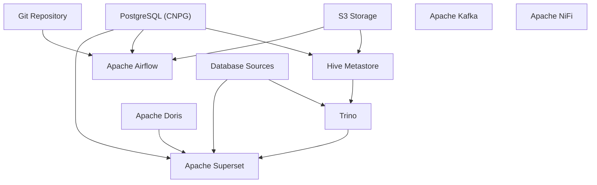

<!--
SPDX-FileCopyrightText: Copyright © 2026 Mohd Izhar Firdaus Bin Ismail
SPDX-License-Identifier: AGPLv3+
-->

# Connectivity & Platform Services Administration

This chapter covers administering project-scoped connectivity resources, external data sources, and the full lifecycle of deployed platform services.

---

## 1. Connectivity Resources

All items under the **Connectivity** sidebar section are **project-scoped** (`ProjectScopedNamedBase`), meaning each credential or certificate belongs to a specific Project and cannot be used across project boundaries.

### S3 Storages (`/s3-storages`)
Used by **Hive Metastore** (warehouse directory) and **Apache Airflow** (remote task logging).
- **Fields**: `region`, `access_key`, `secret_key` (encrypted), `endpoint_url` (optional, for MinIO/Ceph/S3-compatible storage; must start with `http://` or `https://`), and `verify_ssl`.
- **Connection Testing**: `POST /api/v1/s3-storages/_test-connection` verifies credentials by calling `list_buckets` via `boto3`.
- **Integrated S3 Browser**: Users with `s3_storage:fs_read` (`GET /api/v1/s3-storages/{id}/_fs`) can list buckets, browse directories, and generate 1-hour presigned download URLs. Users with `s3_storage:fs_write` (`POST /api/v1/s3-storages/{id}/_fs`) can upload (`put`) and delete (`rm`) objects.

### SSH Keys (`/ssh-keys`)
Used for SSH authentication against private Git repositories.
- **Algorithms Supported**: `rsa` (key sizes `2048` or `4096`, default `4096`) and `ed25519`.
- **Key Management**: Private keys are encrypted with Fernet at rest and redacted in API responses; public keys remain visible so administrators can register them as deploy keys in GitHub, GitLab, or Gitea.

### Git Repositories (`/git-repos`)
Used by **Apache Airflow** for automatic DAG synchronization (`git-sync`).
- **Supported URL Schemes**: `http://`, `https://`, `git@`, and `ssh://`.
- **Authentication**:
  - **SSH**: Link an `ssh_key_id` from the project's SSH Keys.
  - **HTTP/HTTPS**: Provide `username` and `password` (Personal Access Token or password, encrypted at rest).
  - **Anonymous**: Leave credentials blank for public repositories.
- **Connection Testing**: `POST /api/v1/git-repos/_test-connection` executes `git ls-remote <url> HEAD` in an isolated environment to verify reachability and credentials.

### Container Registries (`/container-registries`)
Stores credentials (`url`, `username`, `password`) for private OCI/Docker registries.
- **Connection Testing**: `POST /api/v1/container-registries/_test-connection` performs an OCI `/v2/` handshake supporting both Bearer Token authentication (`Www-Authenticate` realm/service token exchange) and HTTP Basic authentication (including automatic `docker.io` to `registry-1.docker.io` normalization).

### Trusted Certificates (`/trusted-certs`)
Allows administrators to register custom Root or Intermediate CA certificates (PEM format starting with `-----BEGIN CERTIFICATE-----`) within a project.
- **Automatic Pod Injection**: When any platform service is deployed in the project, `PlatformService` automatically fetches all `TrustedCert` records for that project and injects a `trusted_cert_init_container` (`trusted_cert_pod.yml.j2`) and secret bundle so pods trust internal enterprise CAs (e.g., for LDAPS, internal S3 endpoints, or HTTPS Git servers).
- **Certificate Inspection**: `GET /api/v1/trusted-certs/{id}/_decode` parses and returns the X.509 Subject, Issuer, validity window (`valid_from`, `valid_to`), serial number, signature algorithm, and Subject Alternative Names (SANs).

### Database Sources (`/database-sources`)
Under **Data Sources > Database Sources**, administrators and users register external databases (`engine`, `host`, `port`, `database`, `schema_name`, `username`, `password`).
- These sources can be attached directly to **Trino** (to auto-generate catalog properties) and **Apache Superset** (to auto-register database connections).

---

## 2. Platform Services Overview

Mindweaver orchestrates 8 core data platform services under **Infrastructure** (`/api/v1/platform/{service}`). Each service inherits from `PlatformService` and renders Jinja2 Kubernetes/ArgoCD manifests.

### Supported Platform Services & Requirements

| Service | API Prefix | Required Cluster Operator | Service Dependencies & Validation Rules |
| :--- | :--- | :--- | :--- |
| **PostgreSQL** | `/api/v1/platform/pgsql` | CloudNativePG (`cnpg`) | **`instances` must be a positive odd number (`1, 3, 5, ...`)** for quorum. CPU/Memory requests cannot exceed limits. |
| **Apache Doris** | `/api/v1/platform/doris` | Doris Operator | **`fe_replicas` must be a positive odd number (`1, 3, 5, ...`)** for FE quorum; `be_replicas >= 1`. Configurable `fe_storage_size` (default `10Gi`) and `be_storage_size` (default `50Gi`). |
| **Hive Metastore** | `/api/v1/platform/hive-metastore` | ArgoCD | Requires a deployed **PostgreSQL** instance (`database_id`) and optional **S3 Storage** (`s3_storage_id`). Supports Iceberg REST catalog (`iceberg_enabled: true`). |
| **Trino** | `/api/v1/platform/trino` | ArgoCD | **Requires at least one catalog**: either a **Hive Metastore** (`hms_ids`) or a **Database Source** (`database_source_ids`). Supports custom JSON access control `rules`. |
| **Apache Kafka** | `/api/v1/platform/kafka` | Strimzi (`kafka-operator`) | `replica_count` must be between `1` and `9` (default `3`). Supports `storage_size` (default `20Gi`) and custom broker `additional_properties`. |
| **Apache NiFi** | `/api/v1/platform/nifi` | NiFiKop (`nifikop-operator`) | Configurable `replica_count`, `storage_size` (default `10Gi`), `additional_properties`, and LDAP `auth_role_mapping` (valid roles: `Admin`, `Reader`). |
| **Apache Airflow** | `/api/v1/platform/airflow` | ArgoCD | Requires a deployed **PostgreSQL** instance (`platform_pgsql_id`). Supports Valkey/Redis broker (`redis_enabled`), remote S3 logs (`s3_storage_id`, `logs_s3_bucket`), DAGs `git-sync` (`git_repo_id`, `dags_git_branch`, `dags_git_subpath`), and LDAP `auth_role_mapping` (valid roles: `Admin`, `User`, `Op`, `Viewer`, `Public`). |
| **Apache Superset** | `/api/v1/platform/superset` | ArgoCD | Requires a deployed **PostgreSQL** instance (`platform_pgsql_id`). Automatically registers selected `database_source_ids`, `trino_ids`, and `doris_ids`. Supports LDAP `auth_role_mapping` (valid roles: `Admin`, `Alpha`, `Gamma`, `sql_lab`, `Public`). |

---

## 3. Platform Lifecycle, Name Tracking & Dependency Enforcement

### Global Name Uniqueness (`NameTracker`)
To prevent Kubernetes resource, DNS, and ArgoCD Application naming collisions:
- Before creating any platform service, Mindweaver checks `NameTracker` (`mw_name_tracker`). If the `name` is already in use, creation is rejected.
- A daily Celery task (`scan-and-clean-names-daily`) and application startup hook scan all platform tables and prune stale `NameTracker` entries that no longer correspond to an existing service.

### Deploying & Updating (`/_deploy`)
1. **Deployment**: Calling `POST /api/v1/platform/{service}/{id}/_deploy` (requires `Execute` permission):
   - Renders the service's `.yml.j2` templates with project variables, stack image/chart versions, and trusted certificates.
   - Ensures the target namespace exists and reconciles Cert-Manager certificates (`reconcile_manifest_certificates`) so any rotated CA certificates are reissued.
   - Applies all manifest resources to the target cluster (creating new resources or merge-patching existing ones on `409 Conflict`).
   - Marks the platform's state table (`active = True`) and records all upstream dependencies in `DependencyTracker` (`mw_dependency_tracker`).
2. **Automatic Redeployment on Update**: Updating an **active** platform service (`PUT /api/v1/platform/{service}/{id}`) automatically re-renders and re-applies the manifests to the cluster and refreshes the status.

### Decommissioning (`/_decommission`) and Dependency Protection
To remove a service's Kubernetes resources while keeping its configuration record in Mindweaver, use **Decommission**:
- **Confirmation Header Required**: `POST /api/v1/platform/{service}/{id}/_decommission` requires the HTTP header `X-RESOURCE-NAME: <resource.name>` to prevent accidental teardown.
- **Active Dependency Enforcement**: Before decommissioning, Mindweaver queries `DependencyTracker` for any active dependent services (for example, trying to decommission a PostgreSQL cluster that is still used by an active Airflow, Superset, or Hive Metastore instance). If active dependents exist, decommissioning is blocked with:
  `Cannot decommission <name>: dependent service(s) ... are not decommissioned yet.`
- **Force Decommission (`force=True`)**:
  - Passing `{"force": true}` in the request body allows decommissioning to proceed and clears the Mindweaver state **when the target Kubernetes cluster is offline/unreachable** or returns resource deletion errors.
  - **Important**: `force=True` **never** bypasses the active service dependency check. You must always decommission downstream consumer services (e.g., Superset, Airflow, Trino, Hive Metastore) before decommissioning their upstream dependencies (e.g., PostgreSQL).

### Deleting a Platform Record (`DELETE`)
- A platform service record can only be deleted (`DELETE /api/v1/platform/{service}/{id}`) when it is **inactive** (`active == False`, i.e., never deployed or already decommissioned). Attempting to delete an active service returns a validation error instructing you to decommission it first.
